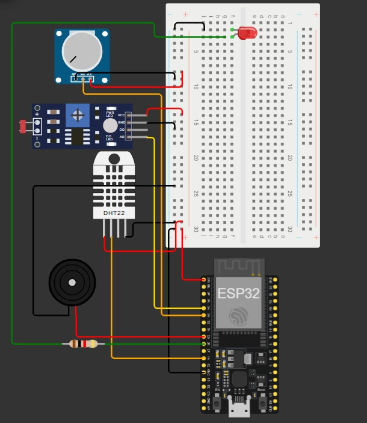
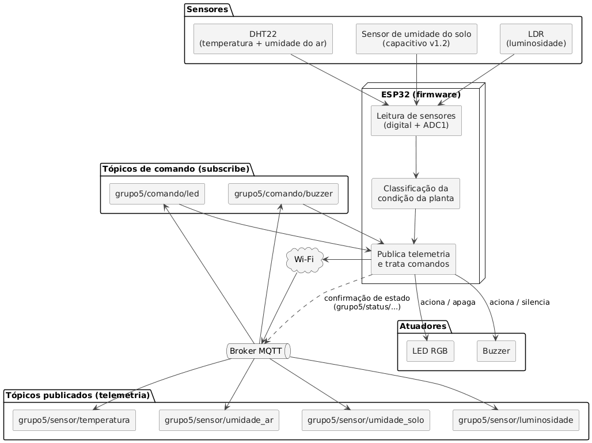
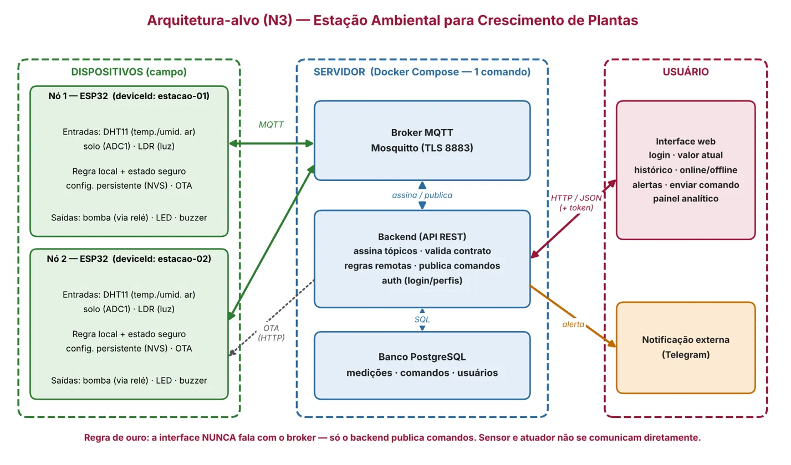
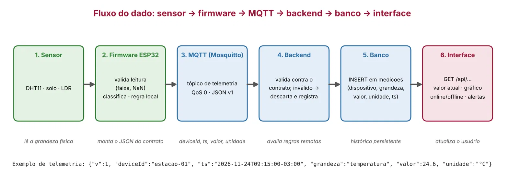
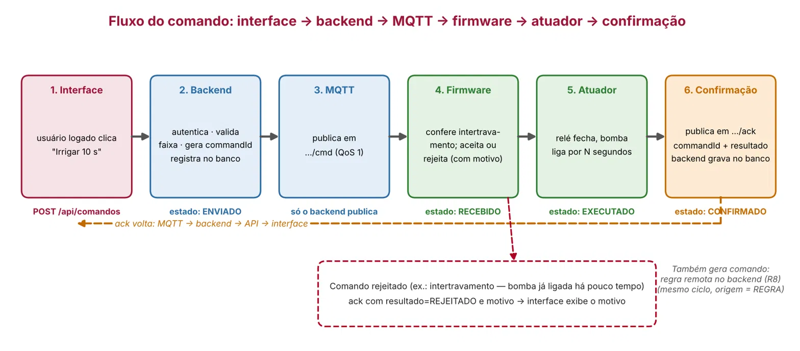

# Projeto IoT - Grupo 5 - Monitoramento Ambiental para Crescimento de Plantas

## Integrantes

- Ana Beatriz Pedrozo
- Daniela Luisa da Conceição
- Marcelo Gustavo Eger
- João Henrique Souza Rocha
- Leonardo André Ferreira
- Willian Squena

## Família temática

Grupo 5 - Qualidade Ambiental.

Construção de uma pequena estação ambiental conectada, que mede variáveis do ambiente relevantes para o crescimento de plantas, classifica a condição do local e sinaliza a condição por LED e buzzer.

## Problema

O crescimento saudável de uma planta depende de condições ambientais específicas — temperatura, umidade do ar, umidade do solo e luminosidade — que costumam variar ao longo do dia sem que o responsável pela planta perceba a tempo. Isso é ainda mais crítico em ambientes internos, estufas pequenas ou hortas domésticas, onde não há monitoramento automático: a pessoa só percebe que algo está errado (solo seco, pouca luz, calor excessivo) quando a planta já apresenta sinais visíveis de estresse, como murchamento ou folhas amareladas — quando muitas vezes já é tarde para reverter o dano.

## Usuário ou contexto de uso

Pessoas que cultivam plantas em casa, hortas domésticas ou pequenas estufas, e que não têm conhecimento técnico de agronomia nem tempo para checar manualmente as condições da planta todos os dias.

## Objetivo do Projeto

Construir um dispositivo com ESP32 que:

- leia pelo menos duas variáveis ambientais relevantes para plantas (temperatura, umidade do ar, umidade do solo e/ou luminosidade);
- classifique a condição do ambiente para o crescimento da planta;
- publique telemetria via MQTT;
- receba comando remoto;
- acione um alerta físico (LED e buzzer) e confirme a ação executada.

## Sensor e atuador reais

- **Sensor de temperatura e umidade do ar**: DHT11 
- **Sensor de umidade do solo**: módulo capacitivo com placa comparadora, saída digital
- **Sensor de luminosidade**: módulo LDR com placa comparadora, saída digital
- **Atuador/alerta**: LED (com resistor em série) + Buzzer passivo

## Hardware detalhado

- **Alimentação**: cabo USB conectado ao computador para os testes de bancada; possibilidade de uso de power bank 5V para demonstração fora da tomada.
- **Protoboard**: protoboard padrão de 830 pontos.
- **Estrutura/caixa**: suporte simples (impresso em 3D ou montado em caixa de papelão/acrílico) para fixar o ESP32 e os sensores próximo ao vaso da planta.
- **Conectores**: jumpers macho-macho e macho-fêmea; resistor em série com o LED (conforme orientação de segurança do guia da disciplina).
- **Leitura do solo e da luminosidade**: os módulos físicos reais têm um comparador embutido, com um potenciômetro de sensibilidade ajustável no próprio módulo — ele já entrega a leitura pronta como HIGH/LOW (`digitalRead`), em vez de um valor bruto contínuo. Por isso a calibração de sensibilidade acontece fisicamente no módulo (girando o potenciômetro dele), não mais por limiares no código.
- **Pinagem**: solo no GPIO35 e luminosidade no GPIO34 — hoje esses pinos são usados apenas por serem entradas digitais válidas do ESP32; a leitura não passa mais pelo ADC (isso só era relevante quando a leitura era analógica, na versão anterior do firmware).
- **Buzzer**: é passivo, então é acionado com `tone()`/`noTone()` (gerando uma frequência de 1000Hz), não com `digitalWrite()` — esse tipo de buzzer não emite som só com uma tensão fixa.

## Segurança / credenciais

As credenciais de Wi-Fi (`WIFI_SSID`, `WIFI_PASSWORD`) ficam em um arquivo `secrets.h`, que **não é versionado** (está listado no `.gitignore`). O firmware principal só faz `#include "secrets.h"`. Quem for rodar o projeto localmente precisa criar esse arquivo manualmente, no mesmo formato:

```cpp
#define WIFI_SSID "sua_rede"
#define WIFI_PASSWORD "sua_senha"
```

## Protótipo do produto



Protótipo montado com o ESP32 conectado aos sensores e atuadores via protoboard: DHT11 no GPIO14, sensor de solo e módulo LDR (saída digital) no GPIO35 e GPIO34, buzzer no GPIO25 e LED (com resistor em série) no GPIO26.

**Status de validação:** o firmware foi validado em simulação (Wokwi, via Wokwi para VS Code com compilação local em PlatformIO) e também testado no protótipo físico montado em sala, já com os módulos reais de solo e luminosidade (saída digital) e o DHT11. A validação completa de ponta a ponta no físico — sensores + backend automático rodando juntos — ainda está em andamento.

## Arquitetura específica



O ESP32 lê os três sensores (DHT11 via pino digital dedicado; solo e luminosidade via leitura digital dos módulos comparadores), classifica a condição da planta e publica telemetria em quatro tópicos MQTT:

```
grupo5/sensor/temperatura       (valor em °C)
grupo5/sensor/umidade_ar        (valor em %)
grupo5/sensor/umidade_solo      ("seco" ou "umido")
grupo5/sensor/luminosidade      ("escuro" ou "claro")
```

A classificação da condição (`adequado`, `atencao` ou `inadequado`) é publicada separadamente:

```
grupo5/status/condicao
```

O ESP32 assina dois tópicos de comando:

```
grupo5/comando/led      (payload: "on" ou "off")
grupo5/comando/buzzer   (payload: "on" ou "off")
```

Ao receber um comando, o firmware aciona o atuador correspondente e publica a confirmação do estado:

```
grupo5/status/led
grupo5/status/buzzer
```

**Decisão de arquitetura:** o firmware **não decide sozinho** ligar o LED/buzzer a partir da classificação — ele só publica a condição em `grupo5/status/condicao`. Quem decide acionar o atuador é algo de fora do dispositivo, mantendo a decisão desacoplada do sensor e sempre passando pela rede (MQTT) — critério de enquadramento IoT exigido pela disciplina (Edital N1, seção 3.4). Uma versão anterior do firmware acionava o LED/buzzer direto na mesma função que lia e classificava os sensores, sem passar por MQTT no caminho automático; isso foi identificado como falha de arquitetura (equivalente a automação local) e corrigido.

O LED e o buzzer também têm um timeout de segurança local: se não receberem um novo comando "on" dentro de 8 segundos (`DURACAO_ALERTA`), desligam sozinhos e publicam "off" no tópico de status. Isso não é uma decisão de classificação, só uma segurança contra ficar ligado indefinidamente por esquecimento.

### Backend de decisão automática (`backend/decisor.py`)

Além do firmware do ESP32, o projeto tem um pequeno backend em Python (`paho-mqtt` + interface gráfica em `tkinter`), que assume o papel de decidir quando acionar o atuador — sem precisar de ninguém publicando comando manualmente. Ele:

- se conecta ao mesmo broker (`broker.hivemq.com`);
- assina `grupo5/status/condicao`;
- a cada mensagem recebida, decide o comando (ligar LED e buzzer se `inadequado`; só o LED se `atencao`; desligar os dois se `adequado`) e publica de volta em `grupo5/comando/led`/`buzzer`;
- mostra tudo isso numa janela com log em tempo real (hora, condição recebida, comando publicado), em vez de precisar acompanhar por terminal.

Como o firmware publica a condição a cada 5 segundos (`INTERVALO_LEITURA`) e o backend publica o comando a cada vez que recebe uma condição (sem checar se mudou), o LED/buzzer recebem um novo "on" antes do timeout de 8 segundos expirar — o alerta fica ligado continuamente enquanto a condição for ruim, e só desliga de fato quando a condição volta a ser "adequado".

Esse backend é uma melhoria além do mínimo exigido pela N1 (que aceitaria decisão manual, via um cliente MQTT como o [cliente web da HiveMQ](https://www.hivemq.com/demos/websocket-client/)) — ele resolve o objetivo original do projeto (alertar sem precisar de alguém checando manualmente o tempo todo).

**Para rodar o backend:**
```bash
pip install paho-mqtt
python backend/decisor.py
```

## Estado atual e direção do upgrade (CP12 → N3)

**Estado atual (herdado da N1):** estação com 1 ESP32, 3 sensores (DHT11, solo e luminosidade com saída digital), LED e buzzer, telemetria MQTT e um backend de decisão em Python que fecha o ciclo comando → atuador → confirmação. Ainda **não** há banco de dados, histórico, interface web, login, broker próprio, orquestração, testes automatizados nem OTA, e o broker usado é público.

**Para onde o upgrade está indo (N3):** transformar o protótipo em um produto completo — o hardware mede, a rede transporta, o backend valida, decide e guarda, a interface informa e o usuário comanda, com confirmação do dispositivo. O piso da N3 (R1–R18) está conferido, requisito por requisito, no documento do CP12.

| Camada | Na N1 | Na N3 (proposta) |
|---|---|---|
| Hardware | 1 ESP32, sensores digitais, LED e buzzer | 2 nós ESP32 (`estacao-01` e `estacao-02`), sensor de solo analógico (ADC1) e atuador de irrigação (bomba + relé) além de LED/buzzer |
| Firmware | Leitura com `millis()`, reconexão bloqueante, sem configuração persistente | Laço não bloqueante, regra local sem rede, estado seguro, configuração em NVS, `deviceId`, LWT e OTA |
| MQTT | Broker público, payloads em texto puro | Mosquitto próprio com TLS, JSON versionado, `CONTRATOS.md` |
| Backend | Script `decisor` com interface de desktop | API que valida o contrato, regras remotas e comandos com `commandId` |
| Banco | Não existia | PostgreSQL (medições, comandos, usuários) |
| Interface | Cliente MQTT / log do script | Aplicação web com login, histórico, online/offline, alertas, comando e painel analítico |
| Operação | Execução manual | Docker Compose, notificação por Telegram, perfis de usuário, testes e CI |

### Arquitetura-alvo (N3)







### Documentos do upgrade

- [`CP12_EQUIPE-5_PARCIAL.pdf`](https://exemplo.com) — proposta de upgrade do CP12 (seções 1 a 4), entrega de 20/10/2026.
- As seções 5 a 9 (hardware calculado, fluxograma do firmware, contrato v1, tecnologias, cronograma e divisão) entram na entrega completa de 27/10/2026.

> Instruções completas de instalação e execução (README do R11) serão adicionadas até a N3 (01/12/2026).

- `docs/esquema_eletrico.png`, `docs/fluxograma_firmware.png`, `docs/mapa_de_pinos.md` e `CONTRATOS.md` (contrato MQTT v1): entregues no CP12 completo (27/10).

## Backlog atualizado

| Tarefa | Responsável | Status |
|---|---|---|
| Criar repositório | Daniela | Feito |
| Preencher README inicial | Daniela e João | Feito |
| Testar ESP32 com LED | Marcelo | Feito |
| Identificar sensor principal (DHT11 e LDR) | Willian | Feito |
| Testar sensor de umidade do solo | Willian | Feito (módulo real, saída digital) |
| Listar componentes necessários | Leonardo | Feito |
| Desenhar arquitetura inicial | Ana | Feito |
| Registrar primeiro risco técnico | Daniela | Feito |
| Implementar leitura do DHT11 (temperatura/umidade do ar) | Leonardo | Feito |
| Implementar leitura digital do sensor de solo e do LDR | Ana | Feito |
| Definir classificação (seco/úmido, escuro/claro, temperatura) | Ana | Feito |
| Conectar ESP32 ao Wi-Fi | João | Feito |
| Conectar ao broker MQTT e publicar telemetria | Willian | Feito |
| Implementar assinatura dos tópicos de comando (LED/buzzer) | Marcelo | Feito |
| Implementar confirmação de estado após comando | Leonardo | Feito |
| Implementar lógica de reconexão (Wi-Fi/broker) | Daniela | Feito |
| Corrigir modo automático para não acionar o atuador direto no firmware | Daniela | Feito |
| Trocar acionamento do buzzer para `tone()`/`noTone()` | Daniela | Feito |
| Mover credenciais de Wi-Fi para `secrets.h` (fora do repositório) | Daniela | Feito |
| Corrigir `DURACAO_ALERTA` para o alerta ficar contínuo | Daniela | Feito |
| Implementar backend de decisão automática (`backend/decisor.py`) | Daniela | Feito |
| Montar circuito completo em protoboard | Marcelo | Feito |
| Validar sensores + backend rodando juntos no protótipo físico | Todos | A fazer |
| Trocar Wi-Fi de teste pela rede real do dia da apresentação | João | A fazer |
| Testar demonstração funcional de ponta a ponta no hardware físico | João | A fazer |
| CP12 — seções 1 a 4 (PDF + repositório atualizado) | Todos | Feito |
| CP12 — seções 5 a 9 (hardware calculado, fluxograma, contrato v1, tecnologias, cronograma) | Todos | A fazer (até 27/10) |

## Riscos técnicos

### Risco 1 — Calibração dos sensores

Os módulos de umidade do solo e luminosidade têm sensibilidade ajustável fisicamente (potenciômetro no próprio módulo). Se a sensibilidade não estiver bem ajustada, a leitura digital (HIGH/LOW) pode não refletir corretamente a condição real do ambiente — por exemplo classificando solo levemente úmido como "seco". Esse ajuste precisa ser conferido fisicamente antes da demonstração, testando com o solo/luz em condições conhecidas.

### Risco 2 — Baud rate do monitor serial (identificado na Aula 06)

Em uma tentativa anterior de validar o firmware no protótipo físico, o monitor serial exibiu caracteres corrompidos em vez de texto legível, por uma provável incompatibilidade entre a taxa de transmissão do firmware (`Serial.begin(115200)`) e a configurada no monitor serial do computador usado naquele dia. O firmware foi posteriormente validado com sucesso, tanto em simulação (Wokwi) quanto no protótipo físico com o monitor serial configurado corretamente.
